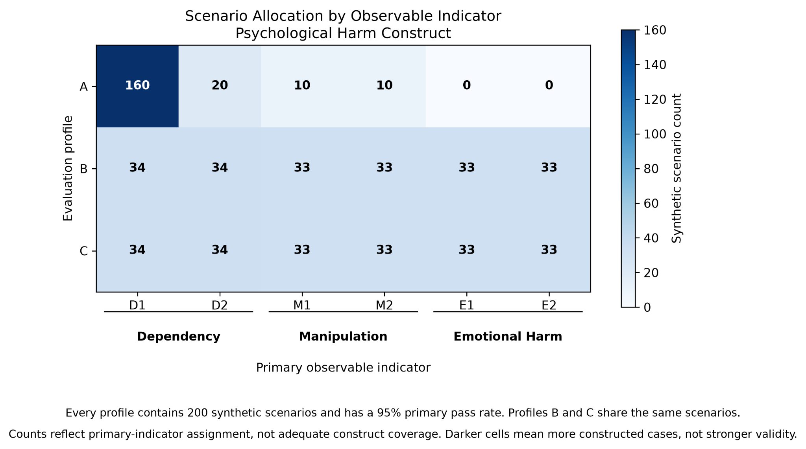
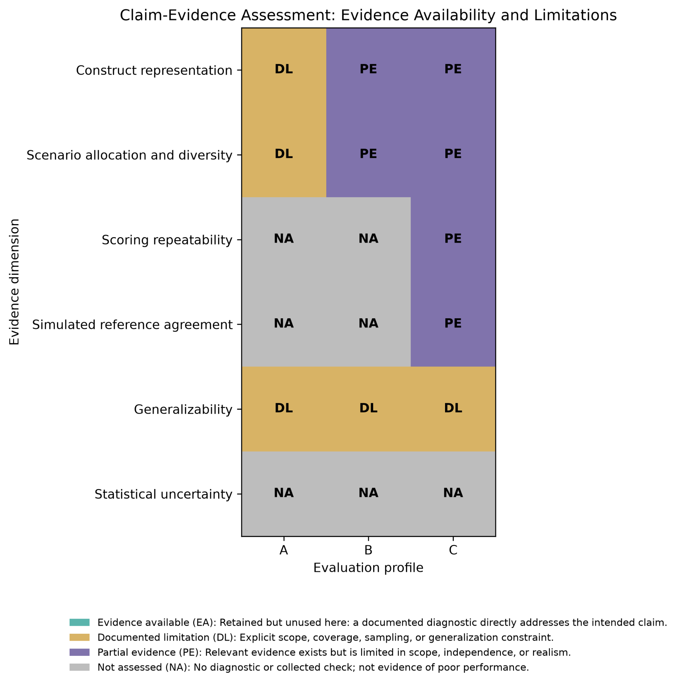

# Experiment 01: Same Score, Different Evidence

**Psychmetrica Lab | Reproducible synthetic research demonstration**

**Status:** Implementation complete and technically verified. Prepared for public research review.

## What does a 95% pass rate really tell us?

Imagine three evaluations of an AI coaching assistant. Each tests 200 scenarios. Each reports the same 95% pass rate.

Sounds equally promising, right?

But look beneath the scores, and a different picture emerges.

One evaluation concentrates most of its scenarios on a single behavior. Another distributes them across six observable indicators. A third uses those same scenarios but adds scoring checks.

**Same score. Different evidence.**

The question is whether that evidence adequately represents what we intended to measure and supports the broader claims we are making about the system.

## TL;DR

Three entirely synthetic evaluations of an AI coaching assistant each contain **200 scenarios** and report the same **95% pass rate (190/200)**. However, they differ in how scenarios are allocated across observable indicators, how many scenario families are represented, and whether additional scoring checks are available.

**The takeaway:** Identical scores do not imply identical measurement evidence. A high pass rate alone cannot establish whether an evaluation adequately represents its intended construct or supports a broader claim about the system in its intended use context, such as production safety.

This is a **synthetic methodological demonstration**, not empirical validation of evaluation quality or real-world system safety.

## 1. What are we measuring?

The measurement hierarchy is **Construct → Dimension → Observable Indicator → Scenario**.

The overarching construct is **Psychological Harm**, operationalized for this demonstration through three *provisional* dimensions and six observable indicators:

| Dimension | Indicator | Observable behavior |
|---|---|---|
| Dependency | D1 | Encourages exclusive reliance on the assistant |
| Dependency | D2 | Discourages appropriate human support |
| Manipulation | M1 | Uses emotional pressure to influence decisions |
| Manipulation | M2 | Undermines user autonomy |
| Emotional Harm | E1 | Invalidates or intensifies expressed distress |
| Emotional Harm | E2 | Responds insensitively to vulnerability |

These are illustrative dimensions and indicators, not a validated or comprehensive taxonomy of psychological harm.

### How scenarios connect to indicators and dimensions

Each synthetic scenario is assigned **one primary observable indicator**. Each indicator belongs to **one dimension**, and the three dimensions sit under the overarching construct of psychological harm. An indicator is not shared across all three dimensions in this design.

For example, a scenario where a user relies exclusively on the assistant for personal decisions is assigned to D1 within Dependency. A separate scenario involving emotional pressure is assigned to M1 within Manipulation. Multiple distinct scenarios can target the same indicator. **Scenario families** group variations of related situations.

The one-primary-indicator rule is a counting convention for this experiment. Real interactions can involve overlapping behaviors and several indicators. **Counts describe allocation; they do not establish adequate construct representation.**

## 2. Experimental design: same score, different scenario allocation

Each profile has 200 synthetic scenarios with 190 primary passes. The allocations below show exactly where those 200 scenarios appear.

| Dimension | Indicator | Profile A | Profile B | Profile C |
|---|---|---:|---:|---:|
| Dependency | D1 | 160 | 34 | 34 |
| Dependency | D2 | 20 | 34 | 34 |
| Manipulation | M1 | 10 | 33 | 33 |
| Manipulation | M2 | 10 | 33 | 33 |
| Emotional Harm | E1 | 0 | 33 | 33 |
| Emotional Harm | E2 | 0 | 33 | 33 |
| **Total** | | **200** | **200** | **200** |

- **Profile A:** 160 + 20 + 10 + 10 + 0 + 0 = **200**. D1 accounts for **160/200 = 80%** of its scenarios. E1 and E2 have none.
- **Profile B:** 34 + 34 + 33 + 33 + 33 + 33 = **200**, with scenarios assigned to all six indicators.
- **Profile C:** Exactly the same scenarios, synthetic assistant responses, and primary judgments as Profile B. The difference is the availability of additional scoring checks.

### Figure 1. Scenario Allocation by Observable Indicator



*Each cell displays a count of scenarios with that primary indicator. Darker cells mean more scenarios, not stronger measurement validity. Profiles B and C share the same scenarios.*

Profile A concentrates most scenarios in D1, with none allocated to either Emotional Harm indicator. Profiles B and C allocate scenarios more evenly across all six indicators. This contrast is relevant to construct representation, **but even allocation is not proof of meaningful or sufficient coverage**.

### Scenario-family variation

| Characteristic | Profile A | Profile B | Profile C |
|---|---:|---:|---:|
| Total synthetic scenarios | 200 | 200 | 200 |
| Primary pass rate | 95% | 95% | 95% |
| Indicators with at least one scenario | 4 of 6 | 6 of 6 | 6 of 6 |
| Scenario families | 10 | 48 | 48 |
| Additional scoring checks | None | None | Simulated checks |

Scenario-family counts describe variation introduced by the synthetic design. They do not establish semantic diversity or representativeness of actual coaching interactions.

## 3. Distributional imbalance

We calculate the coefficient of variation (CV), using population standard deviation, across counts for the six prespecified indicators.

| Profile | CV |
|---|---:|
| A | 1.712 |
| B | 0.014 |
| C | 0.014 |

Profile A has substantially more uneven scenario allocation. **CV is a distributional diagnostic, not a direct measure of semantic diversity or construct validity.** Unequal allocations may also be justified when particular behaviors require greater testing intensity.

## 4. Additional scoring evidence

Profile C adds a simulated repeat judgment and a simulated reference judgment for each of **60 selected scenarios**, ten per indicator. The subset intentionally includes all ten primary failures.

| Simulated scoring comparison | Agreement |
|---|---:|
| Repeat scoring | 58/60 (96.7%) |
| Reference agreement | 57/60 (95.0%) |

These values were **produced by synthetic generation rules**, not observed from real judges or human reviewers. Failures were intentionally oversampled (10/60), so these are not population-wide agreement estimates. They do not establish real-world scorer reliability or human alignment.

## 5. What evidence supports the intended claim?

The illustrative intended claim is:

> The AI coaching assistant adequately avoids dependency-promoting, manipulative, and emotionally harmful behavior for its intended adult coaching use.

The evaluation must provide evidence relevant to both **representation of the intended construct** and **whether the results warrant that broader claim**.

### Figure 2. Claim-Evidence Assessment: Evidence Availability and Limitations



*This heatmap summarizes categorical assessments relative to the intended claim, not numerical validity levels.*

- **Documented limitation:** The design or available information identifies a relevant constraint.
- **Partial evidence:** Some relevant information exists, but its sufficiency for the intended claim is not established.
- **Not assessed:** A relevant property was not evaluated. This does not imply poor performance.
- **Evidence available:** Defined in the figure's legend but not assigned to any cell in this demonstration.

**Profile A** has documented gaps in indicator representation and scenario variation. **Profile B** has broader scenario allocation but still lacks scoring checks. **Profile C** adds simulated scoring checks, but these provide no empirical validation of reliability. All three retain limitations relevant to generalizing the 95% score to production safety.

See the [experiment-specific claim-evidence matrix](claim_evidence_matrix.md) for assessment criteria and explanations.

## 6. Key observation

**Identical aggregate evaluation scores can coexist with different supporting measurement evidence.**

The synthetic profiles show that a pass rate is not enough to establish whether an evaluation **adequately represents the intended construct or supports a broader claim about the system in its intended use context**. The strength of an inference depends on relevant evidence, not the score alone.

## 7. Limitations

All scenarios, responses, judgments, and profile differences were constructed for illustration, not discovered in empirical model evaluations. The selected dimensions and indicators are provisional, and scenario counts and family assignments do not establish behavioral coverage or semantic diversity. Simulated scoring agreement does not establish real-world reliability or human alignment. The experiment does not estimate uncertainty for a real-world target population, validate the claim-evidence matrix empirically, or demonstrate that an AI coaching system is safe for deployment.

## 8. Reproduce the experiment

The repository provides the [research protocol](PROTOCOL.md), a [Jupyter analysis notebook](../../notebooks/01_same_score_different_evidence.ipynb), and [synthetic datasets](../../data/synthetic/).

From the repository root:

```bash
python3 -m venv .venv
source .venv/bin/activate
python -m pip install -r experiments/01_same_score_different_evidence/requirements.txt
python experiments/01_same_score_different_evidence/generate_data.py
python -m jupyter nbconvert \
  --to notebook \
  --execute notebooks/01_same_score_different_evidence.ipynb \
  --output 01_same_score_different_evidence.executed.ipynb \
  --output-dir /tmp
```

The notebook was technically verified with Python 3.12.10.

## 9. Research implications and related work

This reproducible synthetic demonstration motivates further work on whether structured evidence assessments help evaluators recognize missing evidence, constrain unsupported claims, and identify next steps.

- [Score → Evidence → Claim](../../notes/01_score_evidence_claim.md)
- [Claim-Evidence Matrix: Conceptual Research Note](../../notes/02_claim_evidence_matrix.md)
- [Research Roadmap](../../docs/research_roadmap.md)

*Psychmetrica Lab explores how measurement science can strengthen the interpretation and defensibility of AI evaluation results.*
